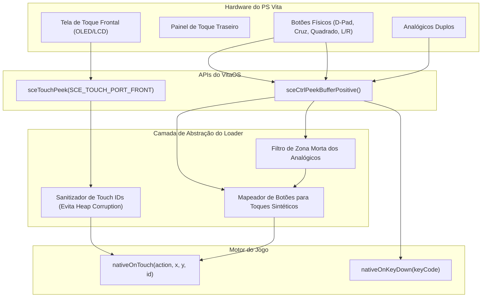

<div class="lang-switch-bar">
  <span>🌐 Language / Idioma:</span>
  <a href="../../08-controls-and-input/" class="lang-switch-link">🇬🇧 English</a>
  <a href="../../es/08-controles-e-input/" class="lang-switch-link">🇪🇸 Español</a>
  <a href="./" class="lang-switch-link active">🇧🇷 Português</a>
</div>

<div class="chapter-hero">
  <span class="chapter-badge">Capítulo 08 • Entrada e Controles</span>
  <h1 style="margin: 0.4rem 0 0.6rem 0; font-size: 2rem;">Controles, Entrada de Toque e Mapeamento Físico</h1>
  <p style="margin: 0; opacity: 0.9; font-size: 1.05rem;">
    Mapeamento de botões analógicos e digitais do PS Vita (SceCtrlData) para eventos de MotionEvent do Android, emulação de multitoque frontal/traseiro e prevenção de buffer overflow.
  </p>
  <div class="chapter-meta">
    <span class="chapter-meta-pill">⚡ Nível: Intermediário</span>
    <span class="chapter-meta-pill">🎮 Controle: SceCtrlData, SceTouchData, Injeção de Toque</span>
    <span class="chapter-meta-pill">🎮 Verificado: Hero of Sparta, Zenonia 3, Badland 2</span>
  </div>
</div>

---

Adaptar os controles de toque de um smartphone para o PlayStation Vita envolve lidar tanto com a tela capacitiva frontal e o painel traseiro quanto com os botões físicos e analógicos.

---

## 🎮 Leitura do Hardware no VitaOS



### 1. Inicialização Obrigatória do Toque
No VitaOS, a amostragem do painel de toque vem **desativada** de fábrica para economizar bateria:

```c
#include <psp2/touch.h>

void init_touch_system(void) {
    sceTouchSetSamplingState(SCE_TOUCH_PORT_FRONT, SCE_TOUCH_SAMPLING_STATE_START);
    sceTouchSetSamplingState(SCE_TOUCH_PORT_BACK, SCE_TOUCH_SAMPLING_STATE_START);
}
```

---

## 💣 A Armadilha do Report ID (Heap Corruption)

### O Problema:
A estrutura `SceTouchReport` da Sony expõe um campo `id`:
```c
SceTouchData touch;
sceTouchPeek(SCE_TOUCH_PORT_FRONT, &touch, 1);
uint8_t raw_id = touch.report[i].id; // Pode assumir valores como 15, 48, 120...
```

Motores Android alocam internamente um array estático de tamanho fixo para os dedos ativos:
```cpp
// Código interno em C++ do motor:
Touch active_touches[5];

void onTouchDown(int pointer_id, float x, float y) {
    active_touches[pointer_id].x = x; // ❌ CRASH SE pointer_id > 4
}
```

Se você repassar o `report.id` cru da Sony (ex: 15) para o motor:
O motor acessa `&active_touches[15]`, **escrevendo fora dos limites do array e corrompendo o heap da aplicação**. O travamento ocorre minutos depois em operações de memória não relacionadas.

### ✅ A Solução: Mapeamento para IDs Virtuais Contíguos

Mapeie os IDs crus da Sony para índices contíguos de `0` a `3`:

```c
#define MAX_TOUCH_SLOTS 4

static int virtual_touch_slots[MAX_TOUCH_SLOTS] = { -1, -1, -1, -1 };

int get_virtual_touch_id(int sony_raw_id) {
    for (int i = 0; i < MAX_TOUCH_SLOTS; i++) {
        if (virtual_touch_slots[i] == sony_raw_id) return i;
    }
    for (int i = 0; i < MAX_TOUCH_SLOTS; i++) {
        if (virtual_touch_slots[i] == -1) {
            virtual_touch_slots[i] = sony_raw_id;
            return i;
        }
    }
    return 0;
}

void release_virtual_touch_id(int sony_raw_id) {
    for (int i = 0; i < MAX_TOUCH_SLOTS; i++) {
        if (virtual_touch_slots[i] == sony_raw_id) {
            virtual_touch_slots[i] = -1;
            break;
        }
    }
}
```

---

## 🕹️ Mapeamento de Botões Físicos para Toques Sintéticos

Para jogos móveis sem suporte a gamepad:

```c
#include <psp2/ctrl.h>

typedef struct {
    uint32_t vita_button;
    float screen_x;
    float screen_y;
    int is_pressed;
} VirtualButton;

static VirtualButton v_buttons[] = {
    { SCE_CTRL_CROSS,    860.0f, 440.0f, 0 }, // Ataque
    { SCE_CTRL_SQUARE,   780.0f, 380.0f, 0 }, // Pulo
    { SCE_CTRL_TRIANGLE, 840.0f, 300.0f, 0 }, // Menu
};

void process_touch_emulation(uint32_t current_buttons) {
    for (int i = 0; i < sizeof(v_buttons)/sizeof(v_buttons[0]); i++) {
        VirtualButton *vb = &v_buttons[i];
        int pressed = (current_buttons & vb->vita_button) != 0;
        
        if (pressed && !vb->is_pressed) {
            nativeOnTouch(0, vb->screen_x, vb->screen_y, 9 + i); // ACTION_DOWN
            vb->is_pressed = 1;
        } else if (!pressed && vb->is_pressed) {
            nativeOnTouch(1, vb->screen_x, vb->screen_y, 9 + i); // ACTION_UP
            vb->is_pressed = 0;
        }
    }
}
```

---

## 🎯 Filtro de Zona Morta (Deadzone) nos Analógicos

Os analógicos do Vita entregam bytes `0..255` com centro ideal em `128`:

```c
#define ANALOG_DEADZONE 30

void read_analog_stick(uint8_t raw_x, uint8_t raw_y, float *out_x, float *out_y) {
    int dx = (int)raw_x - 128;
    int dy = (int)raw_y - 128;
    
    if (abs(dx) < ANALOG_DEADZONE) dx = 0;
    if (abs(dy) < ANALOG_DEADZONE) dy = 0;
    
    *out_x = (float)dx / 128.0f;
    *out_y = (float)dy / 128.0f;
}
```
