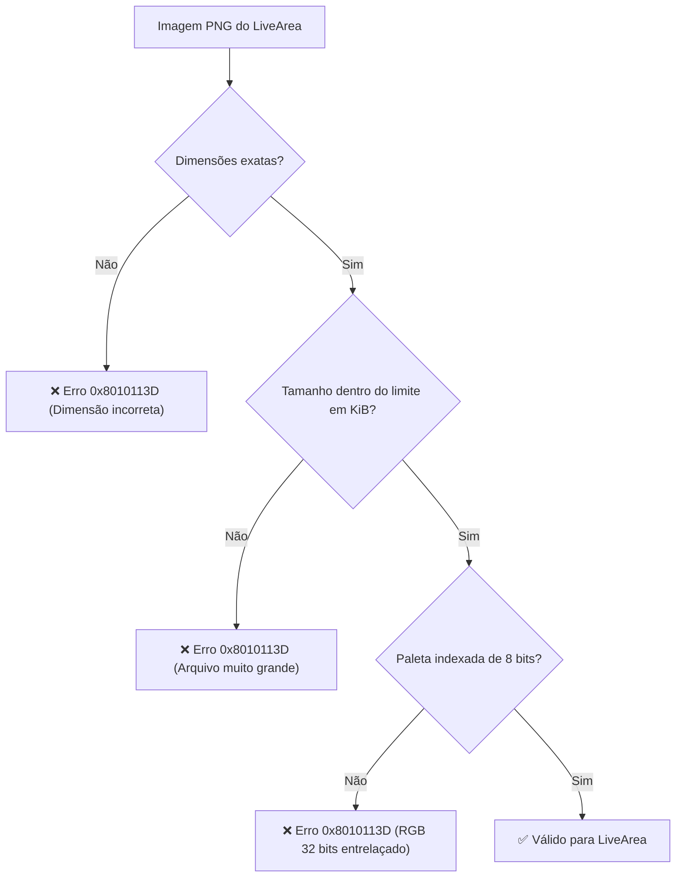

<div class="chapter-hero">
  <span class="chapter-badge">Capítulo 10 • Empacotamento & LiveArea</span>
  <h1 style="margin: 0.4rem 0 0.6rem 0; font-size: 2rem;">LiveArea e Empacotamento de VPK</h1>
  <p style="margin: 0; opacity: 0.9; font-size: 1.05rem;">
    Construção de pacotes de distribuição VPK, configuração de LiveArea (template.xml, icon0.png, bg0.png), resolução do erro 0x8010113D e purga de arquivos AppleDouble do macOS.
  </p>
  <div class="chapter-meta">
    <span class="chapter-meta-pill">⚡ Nível: Intermediário</span>
    <span class="chapter-meta-pill">📦 Formato: Sony SELF, param.sfo, VPK (ZIP)</span>
    <span class="chapter-meta-pill">🎨 Assets: PNG Indexado de 8-bit, Limites SceShell</span>
  </div>
</div>

---

O pacote final instalável no PlayStation Vita é um arquivo com extensão **`.vpk`**. Um VPK é internamente um arquivo ZIP contendo o executável assinado (`eboot.bin`), metadados do sistema (`sce_sys/param.sfo`) e a interface gráfica do sistema (**LiveArea**).

---

## 🖼️ Especificações de Imagens do LiveArea

O shell do sistema (**SceShell**) impõe dimensões rígidas e limites máximos de tamanho de arquivo:

| Recurso | Dimensões (Pixels) | Tamanho Máximo Permitido | Papel no Console |
|---|---|---|---|
| **`icon0.png`** | **128 x 128** | 128 KiB | Ícone circular da bolha na tela inicial. |
| **`startup.png`** | **280 x 158** | 64 KiB | Botão central interativo na porta do LiveArea. |
| **`bg0.png`** | **840 x 500** | 128 KiB | Imagem de fundo da porta do LiveArea. |
| **`pic0.png`** | **960 x 544** | 256 KiB | Imagem de fundo em tela cheia (opcional). |

---

## 🚫 O Erro `0x8010113D` Durante a Instalação

O erro `0x8010113D` no VitaShell ocorre quando uma das imagens do LiveArea viola as especificações da Sony:



### Regras de Ouro:
1. **Paleta Indexada a 8 bits (256 cores):** Quantize as imagens com ferramentas como `pngquant`.
2. **Sem Entrelaçamento (Non-interlaced):** O decodificador de hardware não suporta PNGs progressivos.
3. **Conversão com `psvita-toolkit`:**
   ```bash
   psvita-toolkit livearea --auto extras/livearea/ --validate
   ```

---

## 🍏 Arquivos Fantasma `._*` do macOS

Ao compilar no macOS, o sistema gera metadados AppleDouble (`._icon0.png`, `._eboot.bin`) em volumes FAT32/exFAT.

> [!CAUTION]
> Se arquivos `._*` forem compactados dentro do `.vpk`, a instalação no VitaShell falhará ou criará bolhas corrompidas.

Limpeza obrigatória:
```bash
find . -name "._*" -type f -delete
# Ou:
psvita-toolkit clean-junk
```

---

## 📜 Configuração de `param.sfo`

Gere o arquivo `param.sfo` com o utilitário `vita-mksfoex`:

```bash
vita-mksfoex -s TITLE_ID="PSVHOS001" "Hero of Sparta" param.sfo
```

### Regras do `TITLE_ID`:
- Exatamente **9 caracteres alfanuméricos em maiúsculas**.
- Padrão homebrew comum: `PSV` seguido de letras e números identificadores (ex: `PSVHOS001`).

---

## 📦 Empacotamento Automatizado no CMake

No arquivo `CMakeLists.txt`:

```cmake
vita_create_self(eboot.bin ${PROJECT_NAME})

vita_create_vpk(${PROJECT_NAME}.vpk ${TITLE_ID} eboot.bin
    VERSION "01.00"
    NAME "${GAME_NAME}"
    FILE extras/livearea/icon0.png sce_sys/icon0.png
    FILE extras/livearea/startup.png sce_sys/livearea/contents/startup.png
    FILE extras/livearea/bg0.png sce_sys/livearea/contents/bg0.png
    FILE extras/livearea/template.xml sce_sys/livearea/contents/template.xml
)
```
