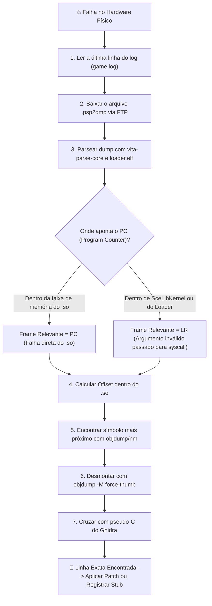

# 11. Triagem de Crashes & Depuração

Quando um port falha no hardware físico, não é preciso adivinhar. A **Metodologia de Triangulação** cruza três fontes de verdade para encontrar a linha exata de código responsável pelo erro:
1. O arquivo de log com flush imediato (`fflush`).
2. O dump de memória do kernel (**`.psp2dmp`**) parseado com `vita-parse-core`.
3. O binário `.so` desmontado com `arm-vita-eabi-objdump -M force-thumb`, cruzado com o pseudo-C do Ghidra e o código Java do `jadx`.

---

## 🎯 O Fluxo de Triangulação de Falhas



---

## 📋 Passo 1: Logs com Descarga Forçada

O log da aplicação deve chamar `fflush(log_file)` após cada linha para garantir que nada fique retido no buffer de escrita quando o console abortar:

```c
void vita_log(const char *fmt, ...) {
    va_list args;
    va_start(args, fmt);
    vfprintf(log_file, fmt, args);
    fflush(log_file); // OBRIGATÓRIO
    va_end(args);
}
```

Analise a última mensagem:
- Se terminar em `GetStaticMethodID(..., "checkLicensing", ...)`: falta um stub JNI.
- Se relatar falha de leitura em arquivo: o caminho precisa ser ajustado no sanitizador.

---

## 🔬 Passo 2: Analisar o `.psp2dmp` com `vita-parse-core`

Ao ocorrer uma exceção (Data Abort ou Prefetch Abort), o VitaOS salva um dump em `ux0:data/` ou `ur0:temp/core/` chamado `psp2core-XXXXXXXXXX-eboot.bin.psp2dmp`.

Analise o dump contra o `loader.elf` compilado com símbolos de depuração:

```bash
python3 vita-parse-core/main.py crash.psp2dmp build/loader.elf
```

Saída:
```
Exception Type: Data abort (read access to 0x00000004)
Registers:
  r0: 0x00000000   r1: 0x98124000   r2: 0x00000001   r3: 0x81005a20
  PC: 0x98045a1c   LR: 0x98045a05   SP: 0x810ff400
```

---

## ⚖️ Passo 3: Decisão entre PC e LR

- **Se `PC` estiver no endereço do `.so` (`0x98000000` em diante):**
  A instrução que quebrou está dentro do código do jogo.
- **Se `PC` estiver no `SceLibKernel` ou no loader (`eboot.bin`):**
  **`LR` (Link Register) é a chave!** Significa que o jogo chamou uma função externa (como `memcpy` ou `fopen`) passando um ponteiro `NULL` ou tamanho inválido. Investigue o ponto de chamada em `LR`.

---

## 🔎 Passo 4: Resolver o Offset e Cruzar com Ghidra

Calcule: `offset = PC - so_base_address` (ex: `0x98045a1c - 0x98000000 = 0x45a1c`).

Localize a função correspondente:
```bash
objdump -T libgame.so | grep -v UND | awk '{print $1, $NF}' | sort > syms.txt
```
Suponha que o offset aponte para `GameRenderer_updateUI + 0x24`.

Desmonte com `-M force-thumb`:
```bash
arm-vita-eabi-objdump -d -M force-thumb --start-address=0x459f8 --stop-address=0x45a30 libgame.so
```

```assembly
   45a18:   6808        ldr     r0, [r1, #0]
   45a1a:   2800        cmp     r0, #0
   45a1c:   6840        ldr     r0, [r0, #4]    ; ❌ r0 é NULL (0x0), tenta ler offset 0x4!
```

Abra o `out_ghidra.c` do Ghidra:
```c
if (player_controller != NULL) {
    player_controller->health_bar->update();
}
```
`player_controller` existia, mas `health_bar` era `NULL` porque o layout visual correspondente ainda não havia sido instanciado pelo FalsoJNI.

---

## ⚠️ Armadilhas de Alinhamento de Memória ARMv7 (Alignment Traps)

Enquanto computadores x86 lidam de forma transparente com acessos à memória desalinhados, **a CPU ARM Cortex-A9 do PS Vita dispara um Data Abort imediato por hardware ao executar instruções como `LDRD` (64 bits), `STRD` ou instruções vetoriais NEON (`VLD1`) se o endereço não estiver alinhado a múltiplos de 8 ou 16 bytes.**

> [!TIP]
> Se o jogo travar em uma instrução `ldrd r2, r3, [r0]` com registradores válidos, verifique `r0`. Se o endereço terminar em `0x4` em vez de `0x0` ou `0x8`, a struct foi alocada de forma desalinhada. Force o alinhamento correto com `memalign(8, size)`.
