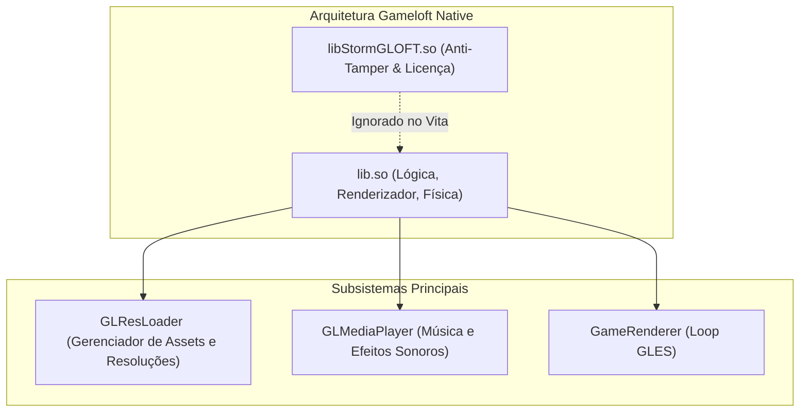
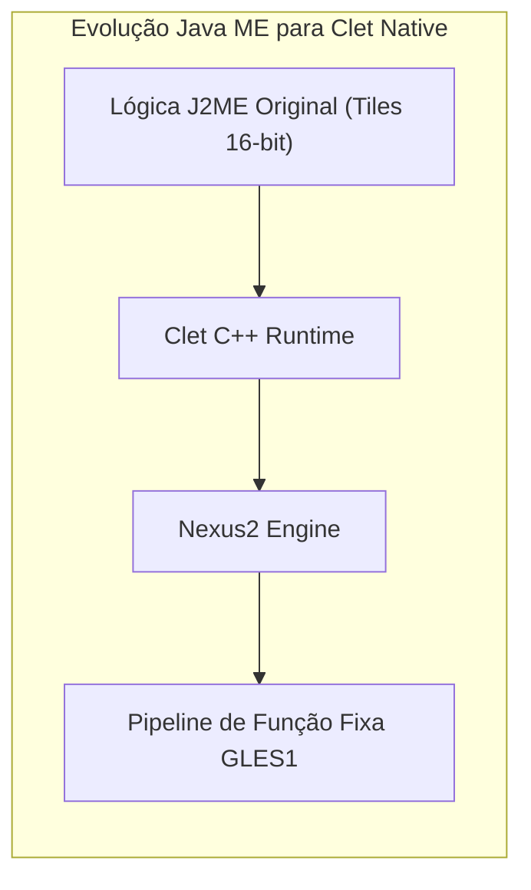

# 12. Arqueologia de Motores Reais

Ao longo do desenvolvimento de mais de 30 ports de PlayStation Vita em produção, padrões recorrentes de arquitetura foram catalogados. Esta seção documenta a estrutura e as particularidades de cada família de motores.

---

## ⚔️ Família 1: Motor Clássico da Gameloft (2010–2013)

**Títulos representativos:** *Hero of Sparta*, *Dungeon Hunter 2*, *N.O.V.A. 2*, *Shadow Guardian*, *Eternal Legacy*, *Six-Guns*, *Gangstar Rio*, *Brothers in Arms 2*, *Asphalt 5 & 6*.

### Particularidades Críticas:
1. **A Biblioteca `libStormGLOFT.so`:**
   APKs da Gameloft dessa época trazem `libStormGLOFT.so` e `lib<jogo>.so`. A primeira é um verificador anti-adulteração sem exports úteis. **Carregamos somente o `.so` principal do jogo.**
2. **Resolução de Assets com `GLResLoader`:**
   Possui suporte a múltiplas pastas de resolução (`1024x768`, `960x540`, `800x480`).
   - Chame `GLResLoader_nativeInit(int)` antes de renderizar qualquer quadro.
3. **Assinaturas JNI Universais:**
   - `Java_..._GLMediaPlayer_nativeInit`
   - `Java_..._GameRenderer_nativeInit(width, height, orientation)`
   - `Java_..._GameRenderer_nativeRender()`

---

## 🛡️ Família 2: Motor Gamevil Nexus2 / Clet

**Títulos representativos:** *Zenonia 2*, *Zenonia 3*, *Zenonia 4*, *Destinia*, *ILLUSIA 1 e 2*, *Advena*.

### Particularidades Críticas:
1. **Herança do Java ME:**
   Originalmente criados para celulares básicos coreanos, a Gamevil encapsulou o código MIDP em um framework nativo C++ (**Clet / Nexus2**).
2. **Símbolos Compartilhados:**
   Zenonia 2 e Zenonia 3 compartilham quase 95% de suas assinaturas JNI: `Java_com_gamevil_nexus2_Natives_nativeInit` e `Java_com_gamevil_nexus2_Natives_nativeEvent`.
3. **Codificação de Texto:**
   Muitos diálogos utilizam EUC-KR ou UTF-8 sem BOM. Ao renderizar com `stb_truetype`, sanitize a entrada para UTF-8 canônico.

---

## 🏹 Família 3: Motores Com2uS

**Títulos representativos:** *Inotia 2: A Wanderer of Luone*, *Inotia 3: Children of Carnia*, *Inmortal Dusk*.

### Particularidades Críticas:
- **Mach-O (iOS) vs ELF (Android):**
  Certos jogos da Com2uS possuíam lançamentos com assets superiores no iOS. Em jogos como *Inotia 2*, carregar o executável **Mach-O de 32 bits** de ARMv7 diretamente no Vita com um loader Mach-O dedicado é uma alternativa prática, convertendo UIKit e CoreAudio em C com vitaGL.
- **Buffers de Áudio:** O áudio opera internamente em PCM mono a 22050 Hz; expanda para estéreo antes do envio para `sceAudioOutOutput`.

---

## 🌳 Família 4: Motores Baseados em Cocos2d-x

**Títulos representativos:** *Badland 2*, *Rayman Jungle Run*, *The Impossible Game*.

### Particularidades Críticas:
- Ponto de entrada padrão: `Java_org_cocos2dx_lib_Cocos2dxRenderer_nativeInit(width, height)`.
- Carregamento de assets via `CCFileUtils`: configure o caminho raiz para `ux0:data/<jogo>/game.apk` para que os dados sejam lidos diretamente do ZIP na memória.
