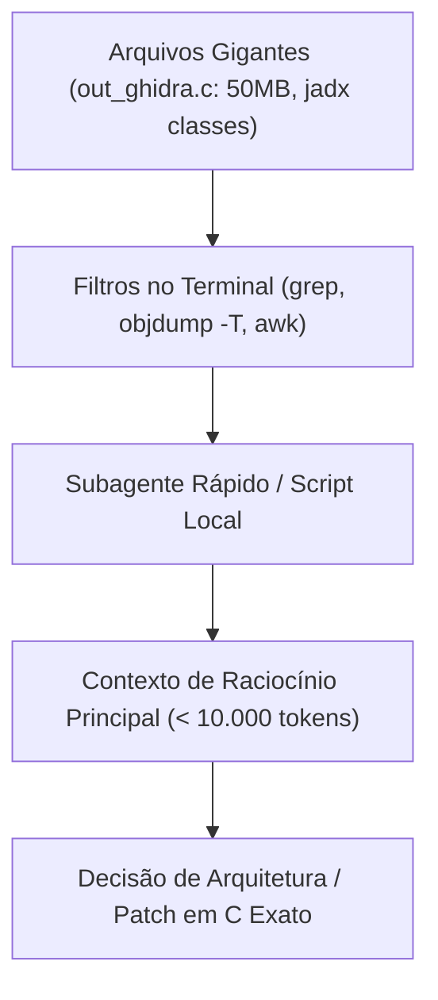

<div class="lang-switch-bar">
  <span>🌐 Language / Idioma:</span>
  <a href="../../13-ai-assisted-porting/" class="lang-switch-link">🇬🇧 English</a>
  <a href="../../es/13-guia-porting-con-ia/" class="lang-switch-link">🇪🇸 Español</a>
  <a href="./" class="lang-switch-link active">🇧🇷 Português</a>
</div>

<div class="chapter-hero">
  <span class="chapter-badge">Capítulo 13 • Pair Programming com IA</span>
  <h1 style="margin: 0.4rem 0 0.6rem 0; font-size: 2rem;">Guia de Porting Assistido com IA</h1>
  <p style="margin: 0; opacity: 0.9; font-size: 1.05rem;">
    Melhores práticas para desenvolvimento em conjunto humano + IA, otimização de 90% em tokens de contexto, mitigação de alucinações em assinaturas JNI e templates de prompts determinísticos.
  </p>
  <div class="chapter-meta">
    <span class="chapter-meta-pill">⚡ Nível: Metodologia</span>
    <span class="chapter-meta-pill">🤖 Ferramentas: Claude, GPT, Antigravity, Subagentes</span>
    <span class="chapter-meta-pill">🎯 Foco: Zero Alucinação, Economia de Tokens</span>
  </div>
</div>

---

O desenvolvimento de ports via SoLoader combina tarefas repetitivas (criação de stubs JNI, tabelas de símbolos, wrappers de áudio) com raciocínio profundo de baixo nível para depurar falhas em hardware real.

Este guia documenta as melhores práticas para trabalhar em parceria (**Pair Programming**) com modelos de IA (Antigravity, Claude, GPT), economizando tokens e evitando alucinações.

---

## ⚡ Economia de Tokens e Gestão de Contexto

Arquivos de descompilação do Ghidra (`out_ghidra.c`), tabelas de símbolos (`objdump`) e classes descompiladas do `jadx` podem ultrapassar facilmente **500.000 tokens**.



### Regras de Ouro:
1. **Nunca envie o `out_ghidra.c` inteiro no chat:**
   Use comandos como `grep -n -C 15 "nome_funcao"` para extrair somente as 30 linhas necessárias.
2. **Delegue código mecânico para modelos leves:**
   Use subagentes rápidos (Flash / Flash-Lite) para formatar tabelas de símbolos e gerar stubs, reservando o modelo de alto raciocínio para os dumps `.psp2dmp`.

---

## 🛡️ Prevenção de Alucinações em Engenharia Reversa

Modelos de IA inventam métodos JNI ou tipos de retorno se o contexto estiver incompleto. Siga estas práticas:

### 1. Forneça assinaturas literais do Java ou do `objdump`
❌ **Prompt Vago:**  
*"Crie o stub para o método de áudio em Hero of Sparta."*

✔️ **Prompt Aterrado:**  
*"A descompilação do jadx mostra esta declaração exata:*  
`public static native int nativePlayMusic(String path, boolean loop);`  
*Escreva a função em C para o FalsoJNI com assinatura `(Ljava/lang/String;Z)I`, converta o jstring para UTF-8, envie para o nosso backend de áudio e retorne streamID > 0 para sinalizar sucesso."*

### 2. Verifique os Tipos Primitivos do JNI
Garanta que a IA respeite estritamente:
- `Z` = `jboolean` (1 byte).
- `J` = `jlong` (inteiro com sinal de 64 bits).
- Nunca retorne ponteiros da stack local em métodos que retornam objetos ou strings.

---

## 📋 Modelo de Prompt para Geração de Stubs em Lote

```markdown
Você é um desenvolvedor especialista em ports de PS Vita usando FalsoJNI.
O jogo reportou os seguintes métodos ausentes no log do console:

1. com.gameloft.android.GLUtils.getDeviceModel() -> Ljava/lang/String;
2. com.gameloft.android.GLMediaPlayer.isMusicActive() -> Z
3. com.gameloft.android.GLResLoader.openAsset(String path) -> [B

Requisitos:
1. Escreva a função em C correspondente com as assinaturas corretas do FalsoJNI.
2. Para strings, retorne fake_NewStringUTF com um valor seguro ("PlayStation Vita").
3. Para booleanos, retorne JNI_TRUE ou JNI_FALSE de acordo com o esperado pelo motor.
4. Forneça as entradas para a tabela de registro jni_methods.
```
