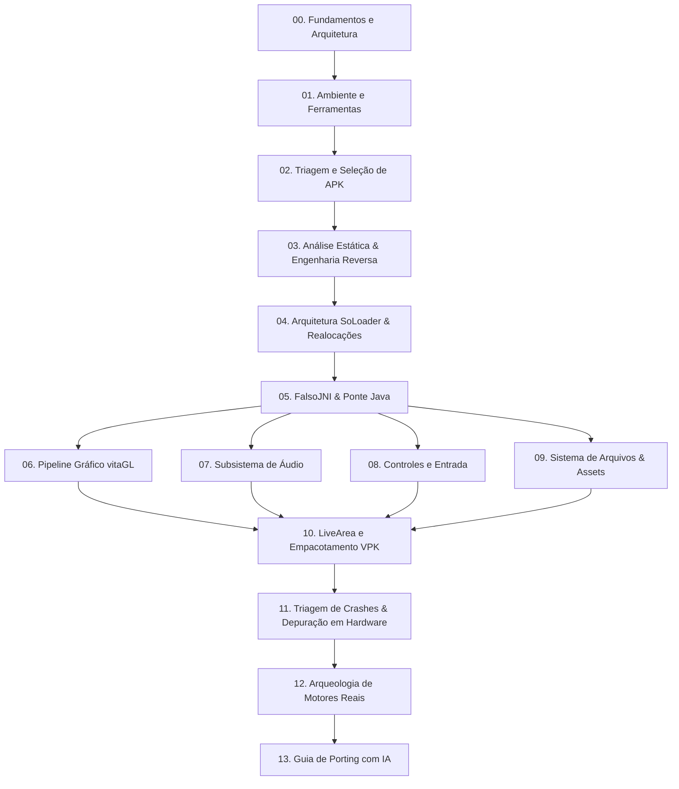

  🌐 Language / Idioma:
  <a href="../" class="lang-switch-link">🇬🇧 English (Default)</a>
  <a href="../es/" class="lang-switch-link">🇪🇸 Español</a>
  <a href="./" class="lang-switch-link active">🇧🇷 Português</a>

  Edição em Português
  <h1 style="margin: 0.4rem 0 0.6rem 0; font-size: 2rem;">Enciclopédia e Guia de Porting para PS Vita (SoLoader)</h1>
  

    Manual completo de engenharia passo a passo e base de referência técnica para transformar um binário compilado de Android (<code>.apk</code> / <code>.so</code>) em um aplicativo nativo executável (<code>.vpk</code>) no PlayStation Vita.
  

## 🧭 Mapa de Navegação do Manual

---

## 📚 Índice de Capítulos

| # | Capítulo | Foco e Conteúdo Técnico |
|---|---|---|
| **00** | [Fundamentos e Arquitetura](00-fundamentos-arquitetura.md) | CPU ARMv7 Cortex-A9, GPU PowerVR SGX543MP4+, partições CDRAM e RAM, SoLoader vs Emulação vs Recompilação Estática. |
| **01** | [Ambiente e Ferramentas](01-ambiente-e-ferramentas.md) | Configuração do VitaSDK, vitaGL, kubridge, fd_fix, FalsoJNI, psvita-toolkit, Docker com Ghidra headless, jadx. |
| **02** | [Triagem e Seleção de APK](02-triagem-e-selecao-apk.md) | Análise preliminar de viabilidade: ARMv7 vs 64-bit, GLES1 vs GLES2, dependências de STL, matriz de decisão. |
| **03** | [Análise Estática & Engenharia Reversa](03-analise-estatica-e-engenharia-reversa.md) | Descompilação de Java (`jadx`), geração de pseudo-C (`Ghidra`), extração de tabelas de símbolos com `objdump` e `nm`. |
| **04** | [Arquitetura SoLoader & Realocações](04-arquitetura-soloader-e-realocacoes.md) | Formato ELF em memória, tabelas de realocação ARM (`R_ARM_RELATIVE`, `R_ARM_GLOB_DAT`), patches binários e hooking. |
| **05** | [FalsoJNI & Ponte Java](05-falsojni-e-ponte-java.md) | Emulação de JVM/JNIEnv, assinaturas de tipo Android, callbacks Java, projeto de stubs ativos e seguros. |
| **06** | [Pipeline Gráfico vitaGL](06-pipeline-grafico-vitagl.md) | vitaGL sobre SCE GXM, tradução de shaders GLSL para Cg/GXP, FBOs, resolução 960x544, alpha pré-multiplicado e VRAM. |
| **07** | [Subsistema de Áudio](07-subsistema-de-audio.md) | `sceAudioOut`, OpenAL-Soft para Vita, decodificação Vorbis/MP3, emulação de `AudioTrack`, `SoundPool` e `MediaPlayer`. |
| **08** | [Controles e Entrada](08-controles-e-entrada.md) | Tela de toque frontal e traseira, botões físicos e analógicos, prevenção de corrupção de heap por report IDs, toque sintético. |
| **09** | [Sistema de Arquivos & Assets](09-sistema-de-arquivos-e-assets.md) | Redirecionamento de caminhos para `ux0:data/`, insensibilidade a maiúsculas/minúsculas no FAT, leitura de ZIP/OBB na RAM. |
| **10** | [LiveArea e Empacotamento VPK](10-livearea-e-empacotamento-vpk.md) | Regras estritas de PNG indexado a 8 bits (evitar `0x8010113D`), `param.sfo`, `template.xml`, limpeza de arquivos `._` do macOS. |
| **11** | [Triagem de Crashes & Depuração](11-triagem-de-crashes-e-depuracao.md) | Metodologia de triangulação: análise de `.psp2dmp`, `vita-parse-core`, `PC` vs `LR`, armadilhas de alinhamento ARMv7 (`ldrd`). |
| **12** | [Arqueologia de Motores Reais](12-arqueologia-de-motores.md) | Dissecação de motores reais de mais de 30 ports: Gameloft, Gamevil Nexus2/Clet, Com2uS, Cocos2d-x. |
| **13** | [Guia de Porting com IA](13-guia-porting-com-ia.md) | Protocolos de colaboração Humano + IA, economia de contexto e tokens, prompts determinísticos para stubs e engenharia reversa. |
| **14** | [Guia Base de gl33ntwine](14-guia-base-gl33ntwine.md) | O artigo clássico de Vitaliy Atamanenko traduzido para português com notas e contexto técnico moderno. |
| **15** | [Referência Rápida & Cheat Sheets](15-referencia-rapida-e-cheatsheets.md) | Assinaturas de tipos JNI, códigos de erro do kernel VitaOS e tabela de correspondência Bionic libc para Newlib. |

---

> [!TIP]
> **Para novos desenvolvedores**: Comece pelos capítulos 00, 01 e 02 antes de baixar qualquer APK.
> **Para desenvolvedores avançados / Agentes de IA**: Os capítulos 04 (Realocações ELF), 05 (FalsoJNI), 06 (vitaGL) e 11 (Triagem de Crashes) contêm a lógica de baixo nível necessária para resolver travamentos complexos no hardware físico.
